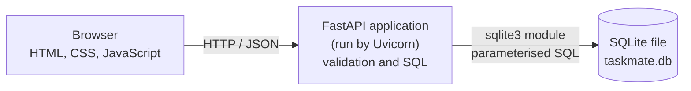
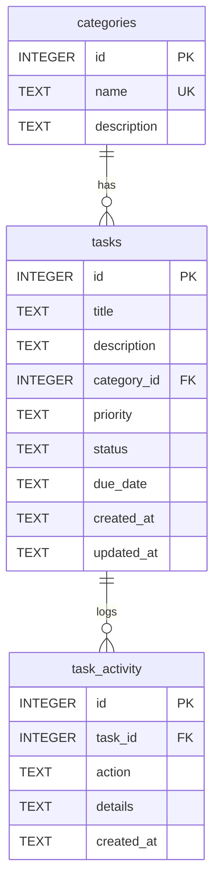

# TaskMate: A Task Management Application Using SQLite

**Course:** Database Systems  **Type:** Case Study Report
**Student:** Manoj K.  **Programme:** B.Tech Computer Science and Engineering, VIT Vellore

---

## 1. Problem Statement

Students and working people keep their to-do items in notebooks, chat messages or memory. Such methods make it hard to see which tasks are unfinished, which are overdue, and how much work has been completed. A small application is needed that stores tasks permanently, lets the user search and filter them, and reports simple statistics.

This case study asks how a lightweight relational database can support such an application. It builds **TaskMate**, a working web application, and uses it to study table design, keys, relationships, SQL queries and transactions in **SQLite**.

## 2. Objectives

1. Design a small relational schema with primary keys, foreign keys and constraints.
2. Implement Create, Read, Update and Delete (CRUD) operations using parameterised SQL.
3. Use `JOIN`, `WHERE`, `LIKE`, `ORDER BY`, `GROUP BY` and `COUNT` in a real application.
4. Keep an activity history of task events using database transactions.
5. Show that data persists after the application restarts.
6. Compare SQLite with PostgreSQL, a conventional client-server relational database.

## 3. Selected Technology

| Layer | Technology | Role |
|---|---|---|
| Database | SQLite (file `taskmate.db`) | Stores all data in one file, accessed through Python's built-in `sqlite3` module |
| Backend | Python with FastAPI, run by Uvicorn | REST API that validates input and runs SQL |
| Frontend | HTML, CSS, JavaScript | Dashboard in the browser; talks to the API using `fetch` |
| Testing | pytest with FastAPI `TestClient` | Automated tests on a temporary database |

**Role of SQLite.** SQLite is a relational database engine that runs inside the application process as a library. It has no separate server to install or start, and the whole database is one ordinary file. This makes it well suited to a single-user local application such as TaskMate. SQLite supports standard SQL, primary and foreign keys, `CHECK` constraints, indexes, joins, aggregation and ACID transactions. It is a relational database, not a NoSQL database.

## 4. Proposed Solution

TaskMate is a browser dashboard backed by a REST API. A user can add, view, edit and delete tasks, mark them completed or reopen them, search by title, filter by category, priority and status, and sort by due date. A statistics panel shows total, pending, in-progress, completed and overdue tasks and the completion percentage. A **Database Insights** page shows the database name, tables, relationships, counts, grouped results and the live results of several SQL queries.

### System architecture



The browser never touches the database. Every read or write goes through an API endpoint, which validates the input and then runs a parameterised SQL statement.

## 5. Database Design

The design uses three tables.

* **categories** holds the category names once (Study, Project, Personal, Work, and any the user adds).
* **tasks** holds the tasks. Each task points to at most one category through `category_id`.
* **task_activity** records events such as creation, update, completion, reopening and deletion.

Category names are stored only in `categories`. A task stores the category's `id`, so renaming or reusing a category never requires copying text into many task rows.

### ER diagram



## 6. Table Structures and Relationships

### categories

| Column | Type | Constraints |
|---|---|---|
| id | INTEGER | PRIMARY KEY AUTOINCREMENT |
| name | TEXT | NOT NULL, UNIQUE |
| description | TEXT | |

### tasks

| Column | Type | Constraints |
|---|---|---|
| id | INTEGER | PRIMARY KEY AUTOINCREMENT |
| title | TEXT | NOT NULL |
| description | TEXT | |
| category_id | INTEGER | FOREIGN KEY references categories(id); NULL allowed |
| priority | TEXT | NOT NULL, CHECK in ('Low', 'Medium', 'High') |
| status | TEXT | NOT NULL, CHECK in ('Pending', 'In Progress', 'Completed') |
| due_date | TEXT | ISO date `YYYY-MM-DD`; NULL allowed |
| created_at | TEXT | NOT NULL |
| updated_at | TEXT | NOT NULL |

### task_activity

| Column | Type | Constraints |
|---|---|---|
| id | INTEGER | PRIMARY KEY AUTOINCREMENT |
| task_id | INTEGER | FOREIGN KEY references tasks(id), ON DELETE SET NULL |
| action | TEXT | NOT NULL |
| details | TEXT | |
| created_at | TEXT | NOT NULL |

### Primary keys and foreign keys

A **primary key** uniquely identifies each row in a table. Here every table uses an integer `id` that SQLite assigns automatically (`AUTOINCREMENT`), so no two rows share an id and an id is not reused after deletion.

A **foreign key** is a column whose value must match a primary key in another table. `tasks.category_id` must match an existing `categories.id`, and `task_activity.task_id` must match an existing `tasks.id`. SQLite does not enforce foreign keys unless asked, so TaskMate runs `PRAGMA foreign_keys = ON` on every connection (`app/database.py`).

### One-to-many relationships

* One category can have **many** tasks, but each task has at most one category.
* One task can have **many** activity records, but each activity record belongs to one task.

The "many" side carries the foreign key. Because `tasks.category_id` is nullable, a task may have no category.

### Constraints and indexes

`CHECK` constraints reject any priority or status outside the allowed values, even if the API were bypassed. Indexes are created on `tasks(status)`, `tasks(category_id)`, `tasks(due_date)` and `task_activity(task_id)`, because the application filters, joins and sorts on these columns frequently.

### Design decision: keeping history after deletion

The specification asks for the history of a deleted task to be preserved. If `task_activity.task_id` were `NOT NULL`, SQLite would either refuse to delete a task that has history (the default foreign-key action), or `ON DELETE CASCADE` would delete the history together with the task. Neither preserves history. TaskMate therefore declares `task_id` as nullable with `ON DELETE SET NULL`. After a task is deleted, its history rows remain with `task_id` set to NULL, and the deletion record's `details` text keeps the task's former id and title (for example, "Deleted task #1: 'Persist me'"). This is a deliberate small change from a strict `NOT NULL` column.

## 7. Implementation Details

### Project structure

```
TaskMate/
  app/main.py            REST API, validation, SQL queries
  app/database.py        connection helper, schema initialisation
  app/static/            style.css, app.js
  app/templates/index.html
  database/schema.sql    tables, indexes, starter categories
  tests/test_api.py      automated tests
  report/CASE_STUDY_REPORT.md
```

### REST API

| Method and path | Purpose |
|---|---|
| GET /api/tasks | List tasks; optional `search`, `category_id`, `priority`, `status`, `sort` |
| GET /api/tasks/{id} | One task |
| POST /api/tasks | Create a task |
| PUT /api/tasks/{id} | Edit a task |
| PATCH /api/tasks/{id}/complete | Mark completed, or reopen with `?completed=false` |
| DELETE /api/tasks/{id} | Delete a task |
| GET /api/tasks/{id}/activity | History of one task |
| GET /api/activity | Recent history of all tasks, including deleted ones |
| GET /api/categories, POST /api/categories | List or add categories |
| GET /api/stats | Dashboard statistics |
| GET /api/insights | Data for the Database Insights page |

### Validation and error handling

FastAPI with Pydantic checks every request body: the title must not be blank (maximum 120 characters), priority and status must be one of the allowed values, and the due date must be a valid `YYYY-MM-DD` date. Invalid input returns status 422. A missing task returns 404, an unknown category returns 400, and a duplicate category name returns 409. The frontend shows these messages to the user.

### CRUD operations

| Operation | SQL statement used | Endpoint |
|---|---|---|
| Create | `INSERT INTO tasks ...` | POST /api/tasks |
| Read | `SELECT ... FROM tasks ... JOIN categories` | GET /api/tasks |
| Update | `UPDATE tasks SET ... WHERE id = ?` | PUT, PATCH |
| Delete | `DELETE FROM tasks WHERE id = ?` | DELETE /api/tasks/{id} |

### Safe SQL and transactions

All values reach SQL through `?` placeholders, so user input is never joined into the SQL text. This prevents SQL injection. In the search query, the characters `%` and `_` typed by the user are escaped so they are matched literally.

Each write that touches more than one table runs inside a single transaction (`with conn:`). Creating a task inserts the task row and its "Task created" history row together. Deleting a task inserts the "Task deleted" history row and then deletes the task, so either both happen or neither does.

### Overdue tasks

A task is overdue when its status is not Completed, it has a due date, and the due date is earlier than today's date. The same rule is used in the task list and in the statistics query.

## 8. Important SQL Queries

**Create a task**

```sql
INSERT INTO tasks (title, description, category_id, priority, status, due_date, created_at, updated_at)
VALUES (?, ?, ?, ?, ?, ?, ?, ?);
```

**List tasks with category names (JOIN), filter, search and sort**

```sql
SELECT t.id, t.title, c.name AS category, t.priority, t.status, t.due_date
FROM tasks t
LEFT JOIN categories c ON c.id = t.category_id
WHERE t.title LIKE ? ESCAPE '\'
  AND t.priority = ?
ORDER BY t.due_date IS NULL, t.due_date ASC;
```

`LEFT JOIN` is used so that tasks without a category still appear. `ORDER BY t.due_date IS NULL` places tasks with no due date last.

**Dashboard statistics (GROUP BY and COUNT)**

```sql
SELECT status, COUNT(*) AS n FROM tasks GROUP BY status;

SELECT COUNT(*) FROM tasks
WHERE status != 'Completed' AND due_date IS NOT NULL AND due_date < ?;
```

The completion percentage is the Completed count divided by the total, multiplied by 100.

**Tasks per category, including empty categories**

```sql
SELECT c.name, COUNT(t.id) AS tasks
FROM categories c
LEFT JOIN tasks t ON t.category_id = c.id
GROUP BY c.id
ORDER BY tasks DESC;
```

**Delete with preserved history (one transaction)**

```sql
INSERT INTO task_activity (task_id, action, details, created_at) VALUES (?, 'Task deleted', ?, ?);
DELETE FROM tasks WHERE id = ?;
```

**Activity history of a task**

```sql
SELECT id, task_id, action, details, created_at
FROM task_activity WHERE task_id = ? ORDER BY id DESC;
```

The Database Insights page runs these and other queries against the live database and displays the real rows returned.

## 9. Testing and Results

Seventeen automated tests were written with pytest. Each test creates its own temporary SQLite file, so `taskmate.db` is never modified. The full suite was run once after the application was completed, and **all 17 tests passed**.

| Area tested | Test | Result |
|---|---|---|
| Create a task | `test_create_task`, `test_create_requires_title` | Passed |
| Retrieve tasks | `test_retrieve_tasks` | Passed |
| Edit a task, no duplicate rows | `test_edit_task_does_not_duplicate` | Passed |
| Delete a task, history kept | `test_delete_task_keeps_history` | Passed |
| Search by title, including `%` and `_` | `test_search_tasks` | Passed |
| Filter and sort | `test_filter_and_sort` | Passed |
| Complete and reopen | `test_complete_and_reopen` | Passed |
| Dashboard statistics | `test_dashboard_statistics`, `test_stats_empty` | Passed |
| JOIN returns category names | `test_join_returns_category_name` | Passed |
| Categories (add, duplicate, blank) | `test_categories` | Passed |
| Activity recorded | `test_activity_recorded` | Passed |
| Foreign-key behaviour | `test_foreign_key_behaviour` | Passed |
| CHECK constraints | `test_check_constraints` | Passed |
| Database Insights data | `test_insights` | Passed |
| Persistence after restart | `test_persistence_after_restart` | Passed |

**Foreign-key results.** Creating a task with a category id that does not exist was rejected with status 400, and no partial rows were saved. Deleting a category that is still used by a task was rejected by SQLite with an integrity error.

**Persistence.** Persistence was verified in two ways. The automated test creates a task, shuts down the application, starts a new instance on the same database file, and finds the task. In addition, a real Uvicorn server was started on `taskmate.db`, a task was created through the API, the server was stopped and started again, and the task was returned by `GET /api/tasks` with the statistics unchanged.

**Not verified.** The tests exercise the API and database. The browser interface was not tested by automated browser tests, and the tests were run on Linux rather than on Windows. The pages and scripts were confirmed to be served by the running server. No performance measurements were made.

## 10. Advantages and Limitations

### Advantages

* No database server to install, configure or secure. The database is a single file, so setup on a laptop is simple.
* Full relational features: keys, constraints, joins, aggregation and transactions.
* Easy to back up or copy (copy `taskmate.db`) and easy to inspect with standard tools.
* Parameterised queries and constraints protect data integrity.

### Limitations

* **Single-user design.** TaskMate has no login or user accounts; anyone who can open the page can change the tasks.
* **Limited write concurrency.** SQLite allows one writer at a time for a database file. This is not a problem for one user but would limit a busy multi-user system.
* **No built-in network access.** SQLite is a library, so remote clients cannot connect to the database directly; they must go through the application.
* **Dates are stored as text** in ISO format. SQLite has no separate date type, so the application is responsible for keeping the format valid, which the API validation does.
* **History after deletion.** Deleted tasks' history rows have a NULL `task_id` (see Section 6), so they can only be found through the recent-activity view and the stored text.
* The categories table has no edit or delete feature in the interface.

## 11. Comparison with a Conventional Relational Database Approach

SQLite and PostgreSQL are **both relational databases**. Both store data in tables, use SQL, and support keys, constraints, joins, indexes and transactions. They differ mainly in how they are built and deployed. The comparison below is qualitative; no benchmarks were run.

| Aspect | SQLite | PostgreSQL |
|---|---|---|
| Architecture | Embedded library that runs inside the application process; no separate server | Client-server: a database server process, with applications connecting as clients |
| Deployment | Nothing to install beyond the library; database is one file | Server must be installed, configured and kept running |
| Concurrency | Many simultaneous readers, but one writer at a time | Designed for many concurrent users and writers (multi-version concurrency control) |
| Remote access | None built in; access is through the application that opens the file | Clients connect over a network, with user roles and authentication |
| Users and permissions | No user accounts inside the database | Roles and privileges managed by the server |
| Data types | Flexible typing (type affinity); no dedicated date type | Strict typing with a wide range of types, including dates and timestamps |
| Suitable use cases | Local or single-user apps, prototypes, small tools, embedded and mobile software | Multi-user web systems, shared business databases, larger data and heavy concurrent writes |

For TaskMate, a single-user local application with a small amount of data and no remote access, SQLite is a good fit. If TaskMate became a shared service with many users, accounts and simultaneous writes, a client-server database such as PostgreSQL would be the more suitable choice. Because both use SQL, most of TaskMate's queries would need only small changes to move between them (for example, placeholder style and date handling).

## 12. Conclusion

TaskMate meets the aims of this case study. It is a working task manager whose data lives in a real SQLite file and survives restarts. Its three-table design shows primary keys, foreign keys, one-to-many relationships, `CHECK` constraints and indexes. The application uses `INSERT`, `SELECT`, `UPDATE`, `DELETE`, `WHERE`, `LIKE`, `ORDER BY`, `JOIN`, `GROUP BY` and `COUNT` on real data, and uses transactions to keep related changes consistent. All 17 automated tests passed. SQLite proved to be a simple and capable relational database for a single-user application, while PostgreSQL remains the better choice when many users need to share and write to a database at the same time.

## 13. References

1. SQLite Documentation. https://www.sqlite.org/docs.html
2. SQLite Foreign Key Support. https://www.sqlite.org/foreignkeys.html
3. SQLite Datatypes. https://www.sqlite.org/datatype3.html
4. SQLite Transactions. https://www.sqlite.org/lang_transaction.html
5. Appropriate Uses For SQLite. https://www.sqlite.org/whentouse.html
6. Python Documentation, `sqlite3` module. https://docs.python.org/3/library/sqlite3.html
7. FastAPI Documentation. https://fastapi.tiangolo.com/
8. Uvicorn Documentation. https://www.uvicorn.org/
9. PostgreSQL Documentation, "What Is PostgreSQL?". https://www.postgresql.org/docs/current/intro-whatis.html
